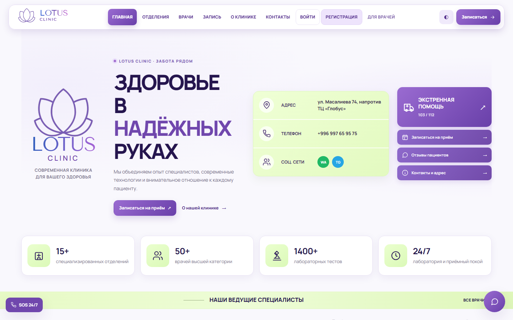
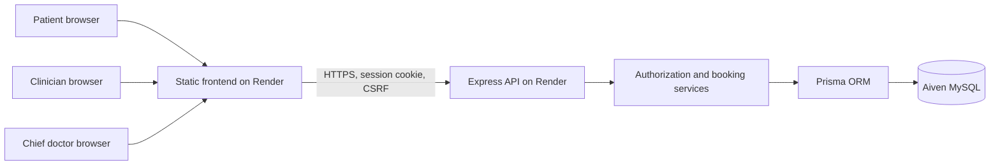
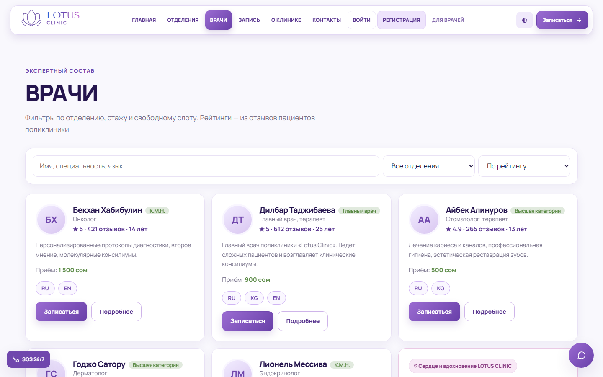
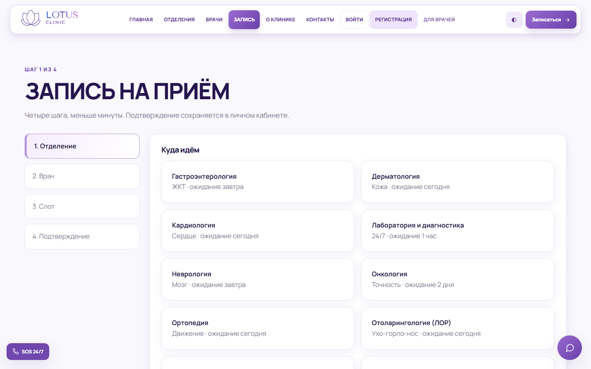
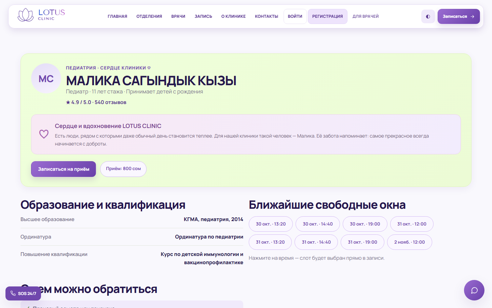
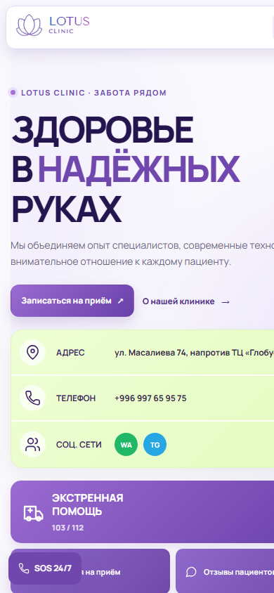

<div align="center">

# 🪷 LOTUS CLINIC

### Full-stack clinic booking & operations platform

A responsive, role-based web application that connects patient bookings, clinical consultations, and clinic administration in a single workflow.

**HTML · CSS · Vanilla JavaScript · Node.js · Express · Prisma · MySQL**

**[Live demo](https://lotus-clinic-web.onrender.com)** · **[API health](https://lotus-clinic-api.onrender.com/api/health)** · **[Architecture](docs/ARCHITECTURE.md)** · **[Demo walkthrough](docs/DEMO_WALKTHROUGH.md)**

</div>



> **Educational portfolio project.** LOTUS CLINIC uses fictional clinic and patient records. It is **not** a production medical records system, has not undergone a medical compliance or penetration-testing audit, and must not be used with real patient data.

## The project

LOTUS CLINIC demonstrates a connected, end-to-end workflow instead of isolated static pages: a patient chooses a doctor and books an available slot; the assigned clinician sees the visit, documents a consultation, and records prescriptions or lab referrals; the patient can view completed consultation information; a chief doctor manages the clinic's operational side.

The design is an original, lavender-themed interface with responsive navigation, patient-facing profiles, and a bespoke presentation for a featured pediatrician.

## Key capabilities

| Patient | Clinician | Chief doctor |
| --- | --- | --- |
| Register, sign in and sign out | Sign in to an assigned doctor account | Manage staff and department details |
| Explore specialties and doctor profiles | See own schedule and patient charts | Manage schedules and room assignments |
| Find available slots and make appointments | Write consultation notes and diagnoses | Review leave requests |
| Cancel bookings and review visit status | Create prescriptions and lab referrals | Manage lab requests and pharmacy stock |
| See completed consultations and treatment details | Review past consultations; view assigned room | Inspect appointments, reports and audit information |

### Notable engineering decisions

- **Shared MySQL data model.** Patient accounts, doctors, bookings, consultations, prescribed medicines, laboratory orders, rooms, leave requests and pharmacy inventory are persisted via Prisma. Schema evolution is tracked in `backend/prisma/migrations/`.
- **Booking concurrency.** Slot reservation is handled server-side with transactional state changes and database constraints to prevent duplicate booking of the same slot.
- **Role-based authorization.** Patient, doctor and chief-doctor routes have server-side access checks. An authenticated doctor's operations are scoped to their own account; patients see their own records.
- **Session authentication.** Argon2 password hashes, server-side sessions, secure-cookie configuration, CSRF checks, rate limiting and audit logging. These are implemented protections, **not** a claim of full security certification.
- **No frontend framework.** The HTML/CSS/vanilla JS frontend calls the Express API directly, with graceful offline catalog fallback and responsive design.

## System overview



Read the [architecture and data-flow notes](docs/ARCHITECTURE.md) for implementation details and tradeoffs.

## Screenshots

Screenshots of **public pages** captured from the deployed Render site on 30 October 2026. No private patient or staff accounts were used.

| Homepage | Doctors |
| --- | --- |
|  |  |

| Online booking | Featured pediatrician |
| --- | --- |
|  |  |

| Mobile view |
| --- |
|  |

> Screenshots show fictional demo content. Patient and staff dashboards are deliberately excluded to avoid publishing health records, personal identifiers, or credentials. For protected views, use a supervised demo with fictional accounts.

## Project structure

```text
Lotus-clinic/
├── lotus/                    # Responsive HTML, CSS, JS, and images
│   ├── css/
│   ├── js/
│   └── *.html
├── backend/
│   ├── src/                  # Express routes, controllers, services, auth
│   ├── prisma/               # MySQL schema, migrations and seed data
│   ├── scripts/              # Syntax and read-only public smoke checks
│   └── tests/                # Automated tests (see safety note below)
├── .github/workflows/        # Backend checks and manual public smoke workflow
└── docs/                     # Architecture, walkthrough and QA notes
```

## Run locally

**Requirements:** Node.js 18+, npm and MySQL 8.x.

1. Clone the repository. Create a **development-only** MySQL database.
2. Copy `backend/.env.example` to `backend/.env`, then set a development `DATABASE_URL`, unique `SESSION_SECRET`/`CSRF_SECRET`, and the local frontend origin. **Never commit `.env`.**
3. Prepare and run the backend:

   ```bash
   cd backend
   npm ci
   npx prisma generate
   npx prisma migrate deploy
   node --env-file=.env src/server.js
   ```

4. In another terminal, serve the static frontend:

   ```bash
   cd lotus
   npx http-server . -p 8000 -a 127.0.0.1
   ```

5. Visit **http://localhost:8000**. The local API runs at **http://localhost:4000**.

For database preparation and configuration details, see [backend/README.md](backend/README.md). The repository does **not** publish staff credentials.

## Testing and verification

```bash
# From repository root: no database access or writes
node --test backend/tests/unit/public-smoke.test.js

# Read-only public deployment verification; does not create accounts/bookings
node backend/scripts/public-smoke.js
```

The public smoke check covers **18** endpoint and access-gate checks. The deployment was observed to pass **18/18** on 30 October 2026; this is a point-in-time check, not an uptime promise. The GitHub workflow under **Actions → Read-only live smoke test** can rerun it on demand.

> **Important:** The broader backend integration suite (`backend/tests/api.test.js`, included in `npm test`) creates and changes database records. Run it **only against a disposable test database**, never the Aiven demo/production service. See [QA checklist](docs/QA_CHECKLIST.md).

## Live demo and access

- **Public web:** https://lotus-clinic-web.onrender.com
- **API health:** https://lotus-clinic-api.onrender.com/api/health
- **Demo data:** fictional; users may register a fictional patient account for the booking experience.
- **Staff accounts:** not published or shared in this repository. Use screenshots, code walkthroughs, or a supervised demonstration of restricted dashboards.

The free Render services may experience a slow initial response after inactivity.

## Current limitations and future work

- Not approved for actual healthcare delivery; no compliance certification, EHR interoperability, external penetration test or complete accessibility audit.
- More automated integration testing is needed for cross-role data isolation, concurrent booking, medical-record workflows and time-zone boundaries.
- Cloud backup/restore verification, observability, secrets rotation and privacy-by-design retention policies would be required before considering real-world use.
- Maintain accurate fictional doctor and patient data; marketing/demo content is not medical advice.

## Further reading

- [Architecture](docs/ARCHITECTURE.md)
- [Guided demonstration](docs/DEMO_WALKTHROUGH.md)
- [Release QA checklist](docs/QA_CHECKLIST.md)
- [Portfolio release notes](docs/PORTFOLIO_RELEASE.md)
- [Project descriptions for CV and interviews](docs/PORTFOLIO_COPY.md)

---

<div align="center">Built as an independent full-stack portfolio project · LOTUS CLINIC</div>
