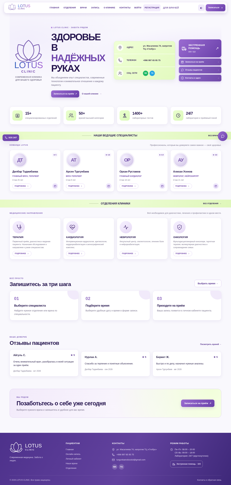
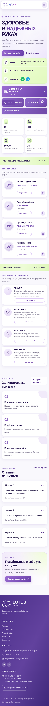

<div align="center">

# 🪷 LOTUS CLINIC

### Medical Clinic Website & Appointment Management System

A full-stack portfolio project featuring patient booking, clinician workflows, and clinic administration.

**Vanilla JavaScript · Node.js · Express · MySQL · Prisma**

</div>



## Overview

LOTUS CLINIC is a medical-clinic web application built to demonstrate an end-to-end appointment workflow. Patients can browse departments and doctors, register, sign in, and book appointments. Doctors can review their schedules and manage visits. Administrators can manage clinic staff and use a demonstration interface for assigning rooms.

> **Portfolio/demo project — not a production medical system.** No real patient information should be entered. Certain administration features (including room assignments) currently use browser `localStorage` rather than shared database persistence.

## Features

| Patient | Doctor | Administrator |
| --- | --- | --- |
| Registration and sign-in | View upcoming appointments | Staff and doctor administration |
| Explore departments and doctors | Review patient visit history | Demonstration room assignment UI |
| Book available appointment slots | Complete appointments | Clinic management interface |
| View appointment status | See assigned room (demo) | Role-based access to admin features |
| Cancel bookings | | |

### Highlights

- **End-to-end booking flow:** patient → API → MySQL → doctor dashboard.
- **Availability handling:** a booked slot is removed from available booking options; cancellation releases the slot.
- **Role-based access:** separate patient, doctor, and administrator experiences, with protected backend routes.
- **Authentication:** password hashing with Argon2 and session-based authentication.
- **Database:** MySQL with Prisma schema and migrations.
- **Responsive UI:** custom lavender-inspired design built with HTML, CSS, and JavaScript.
- **Special clinician presentation:** custom profile and visual details for the pediatrician Malika Sagyndyk kyzy.

## Screenshots

| Desktop | Mobile |
| --- | --- |
|  |  |

## Tech stack

**Frontend:** HTML5, CSS3, vanilla JavaScript  
**Backend:** Node.js, Express  
**Database:** MySQL, Prisma ORM  
**Authentication & security:** Argon2 password hashing, sessions, CSRF protections, API authorization

## Project structure

```text
Lotus-clinic/
├── backend/
│   ├── prisma/          # Schema, migrations, seed script
│   ├── src/             # Express application, routes, controllers
│   ├── tests/           # Backend tests
│   ├── .env.example     # Safe environment template
│   └── README.md        # Backend documentation
├── lotus/
│   ├── css/             # Stylesheets
│   ├── js/              # Client-side application code
│   ├── img/             # Images
│   └── *.html           # Public and dashboard pages
└── README.md
```

## Run locally

**Prerequisites:** Node.js, npm, and MySQL.

1. Clone the repository and create a local MySQL database named `lotus_clinic`.
2. Copy `backend/.env.example` to `backend/.env`; configure a valid `DATABASE_URL`, strong unique `SESSION_SECRET` and `CSRF_SECRET`, and the frontend origin.
3. From the `backend` directory, install dependencies and apply migrations:

   ```bash
   npm ci
   npx prisma generate
   npx prisma migrate deploy
   ```

4. Start the API from the `backend` directory:

   ```bash
   node --env-file=.env src/server.js
   ```

5. In a separate terminal, start a static server from the `lotus` directory:

   ```bash
   npx http-server . -p 8000 -a 127.0.0.1
   ```

6. Open **http://localhost:8000**. The API runs at **http://localhost:4000** by default.

See [`backend/README.md`](backend/README.md) for additional backend notes. Demo/staff credentials are not distributed in the public repository.

## Current limitations & next steps

- Room assignments, laboratory, pharmacy, and leave-request features may rely on **browser-local demo data**; move these into the shared MySQL backend for multi-device use.
- Configure environment-specific frontend API URLs and hosting before publishing a live demo.
- Expand automated integration tests, including permission checks and booking concurrency.
- Review timezone handling, mobile layouts, and production security configuration.
- Use **fictional test data only**; this project has not been audited for real-world medical use.

## Status

**Portfolio project / actively improving.** The application has been manually exercised for registration, login, appointment booking, slot reservation, cancellation, visit completion, and role-restricted access. These checks are not a substitute for a complete automated test suite or security audit.
