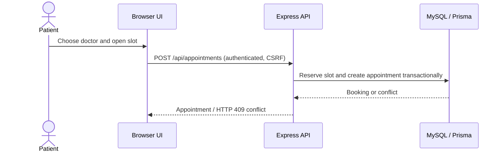

# LOTUS CLINIC — Architecture and engineering notes

LOTUS CLINIC is a **portfolio demonstration** built with a static HTML/CSS/vanilla JS frontend, an Express/Node.js API, Prisma ORM and MySQL. Its purpose is to demonstrate practical full-stack software engineering, **not** suitability for real medical data.

## Components

| Layer | Technology / location | Responsibility |
| --- | --- | --- |
| Browser UI | `lotus/*.html`, `lotus/js`, `lotus/css` | Role-specific pages, forms, client-side rendering and server requests |
| Public API | `backend/src/routes/public.routes.js` | Doctor, department and availability reads |
| Auth/session | `backend/src/controllers/auth.controller.js`, middleware | Registration, login/logout, current identity, server-side authorization and CSRF |
| Booking | Appointment routes, booking/slot services | Slot selection, booking transactions, cancellations |
| Clinical workflow | Doctor, patient and treatment controllers | Consultation notes, prescriptions, lab referrals, patient-only consultation views |
| Operations | Operations and clinical-operations controllers | Shared room assignments, leave requests, laboratory and pharmacy operations |
| Persistence | `backend/prisma/schema.prisma`, `backend/prisma/migrations/` | Versioned MySQL schema and Prisma models |
| Hosting | Render + Aiven | Static frontend, Express API and hosted MySQL service |

## Key flows

### 1. Patient books a slot

### 2. Clinician records a visit

An authenticated clinician opens **their own schedule**. A consultation can contain narrative notes, diagnostic fields and treatment recommendations, with structured prescription rows and laboratory referrals. The patient-facing account queries only the patient's own records. Completing a visit updates the corresponding appointment status. Some clinical actions are intentionally immutable after completion.

### 3. Chief doctor manages operations

`chief` routes are restricted by role in `backend/src/routes/admin.routes.js`. Room assignments, leave approvals, laboratory requests and pharmacy inventory are persisted in MySQL, rather than in browser-local storage. The chief's treatment summary is an aggregate view of consultations and appointments.

## Data-model landmarks

- `User`, `Patient`, `Doctor` — identities and roles, with a linked doctor account where applicable.
- `Department`, `DoctorScheduleTemplate`, `AppointmentSlot`, `Appointment` — catalog and scheduling.
- `MedicalRecord`, `Consultation`, `Prescription`, `LabOrder` — fictional clinical information.
- `Room`, `LeaveRequest`, pharmacy-related models — clinic operations.
- `AuditLog` — selected security and administrative events.

The canonical source is `backend/prisma/schema.prisma`. Avoid assuming that every optional field is populated for all fictional seed records.

## Security boundaries

- Trust **database-backed identity**, not role claims submitted from the browser.
- `requireAuth` / `requireRole` gate protected route groups; data-level scoping is implemented in controllers.
- Sessions are cookie-backed; passwords are hashed with Argon2; mutating routes use CSRF protection.
- CORS is allowlisted for the published frontend origin. A CORS check alone is not authentication.
- Staff credentials are deliberately private and must not appear in README, screenshots or code examples.

**Known gap:** anonymous smoke tests do not prove cross-patient or cross-doctor isolation. Comprehensive security review, automated concurrent-booking stress tests, backup restoration and privacy assessment remain future work.

## Hosting and limitations

Frontend: https://lotus-clinic-web.onrender.com
API: https://lotus-clinic-api.onrender.com
Database: Aiven MySQL, accessed through environment-specific secrets.

Render's free-tier cold starts may delay the initial API response. Browser and database time zones require further edge-case testing. This project **must use fictional patient data only**.
