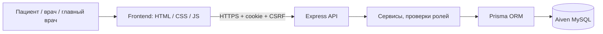

# LOTUS CLINIC — Full-stack система управления клиникой

**[Открыть проект](https://lotus-clinic-web.onrender.com)** · **[Исходный код](https://github.com/Aydenxvi/Lotus-clinic)** · **[Архитектура](ARCHITECTURE.md)**

> **Статус:** учебный full-stack проект для портфолио, работающий на публичном демо-хостинге. В системе допустимы **только вымышленные данные**. Проект не предназначен для реальных пациентов и не проходил регуляторную сертификацию или полноценный аудит безопасности.

## 1. Задача

Создать не просто сайт клиники с красивыми карточками врачей, а связанную систему, в которой пациент может записаться на приём, врач — обработать запись и оформить консультацию, а главный врач — управлять персоналом и ресурсами клиники. Важное условие: действия должны сохраняться на сервере и быть видны между устройствами, а не жить только в браузере.

## 2. Решение

Я разработал LOTUS CLINIC — многостраничное веб-приложение с тремя пользовательскими ролями, единым API и реляционной базой данных.

| Пациент | Врач | Главный врач |
| --- | --- | --- |
| Регистрация, вход, просмотр врачей | Личное расписание и записи пациентов | Управление врачами и отделениями |
| Выбор времени и запись на приём | Просмотр медкарты пациента | Назначение кабинетов и графиков |
| Отмена записи, отслеживание статуса | Жалобы, диагноз, консультация | Согласование заявок на отгул |
| Просмотр завершённых консультаций | Рецепты и направления на анализы | Лаборатория, аптечный склад, отчёты |

### Интерфейс

| Каталог врачей | Онлайн-запись |
| --- | --- |
|  |  |

| Профиль педиатра | Мобильная версия |
| --- | --- |
|  |  |

Интерфейс выполнен в оригинальной светлой лавандовой палитре. Для выделенного профиля педиатра Малики Сагындык кызы создано персональное оформление, не влияющее на права доступа.

## 3. Технологии

- **Frontend:** HTML5, CSS3, vanilla JavaScript — без фреймворка.
- **Backend:** Node.js и Express, REST API.
- **Данные:** MySQL 8, Prisma ORM и версионированные миграции.
- **Авторизация:** сессии, Argon2-хеширование паролей, разделение прав `patient / doctor / chief`, CSRF-защита.
- **Развёртывание:** frontend и backend в Render, облачный MySQL в Aiven, исходный код в GitHub.
- **Проверки:** Node.js тесты и read-only smoke test публичного развёртывания.

## 4. Архитектура

Ключевой принцип — сервер определяет права пользователя по аутентифицированной сессии, а данные записей, консультаций, лаборатории, аптечного склада и кабинетов сохраняются в общей базе. Это позволяет продолжать работу в другом браузере или на другом устройстве.

## 5. Интересные инженерные задачи

**Защита от двойной записи.** При бронировании временного слота применяется серверная логика с транзакцией и ограничениями базы данных. Два клиента не должны успешно забронировать одно и то же время.

**Разграничение ролей.** Пациент обращается к собственным записям, врач — к назначенным ему приёмам и пациентам, главный врач — к административным функциям. Маршруты API ограничены на сервере, а не только скрыты в интерфейсе.

**Полный цикл консультации.** Запись связывается с консультацией, диагнозом, назначенными лекарствами и лабораторными направлениями. Завершённые консультации доступны пациенту в его кабинете.

**Общие данные между устройствами.** Назначения кабинетов и заявки на отгулы перенесены из локальной логики в MySQL и управляются через API.

**Развёртывание и проверка.** Используются отдельные Render-сервисы для статического фронтенда и Express API и отдельная облачная БД. Схема изменяется через миграции Prisma.

## 6. Результаты и проверка

- Публичный сайт и API развёрнуты и доступны по ссылкам выше.
- Проверен сквозной сценарий на вымышленном пациенте: запись → отображение у врача → завершение приёма → изменение статуса у пациента.
- Проверены входы для трёх ролей и отображение назначенного кабинета в другом браузере.
- **30 октября 2026:** read-only проверка опубликованного проекта прошла **18/18** проверок (состояние на дату запуска, не гарантия постоянной доступности).
- В GitHub доступны код, структура базы, миграции, схема архитектуры и реальные публичные скриншоты.

## 7. Ограничения и дальнейшие улучшения

Это **портфолио-демонстрация**, а не сертифицированная медицинская система. Перед использованием с настоящими данными потребовались бы независимая проверка безопасности, конфиденциальности и доступности, политика хранения персональных данных, аудит межролевого доступа, резервного копирования и восстановления, а также отдельные тесты на граничные условия расписаний и часовых поясов.

## 8. Ссылки

- [Live Demo](https://lotus-clinic-web.onrender.com)
- [GitHub Repository](https://github.com/Aydenxvi/Lotus-clinic)
- [Архитектура](ARCHITECTURE.md)
- [Сценарий демонстрации](DEMO_WALKTHROUGH.md)
- [QA checklist](QA_CHECKLIST.md)

**Моя роль:** full-stack разработка — интерфейс, API, модель данных, авторизация, интеграция и развёртывание. При описании проекта в резюме следует указывать фактически выполненную роль и помощь AI-инструментов, если это существенно для демонстрации навыков.
