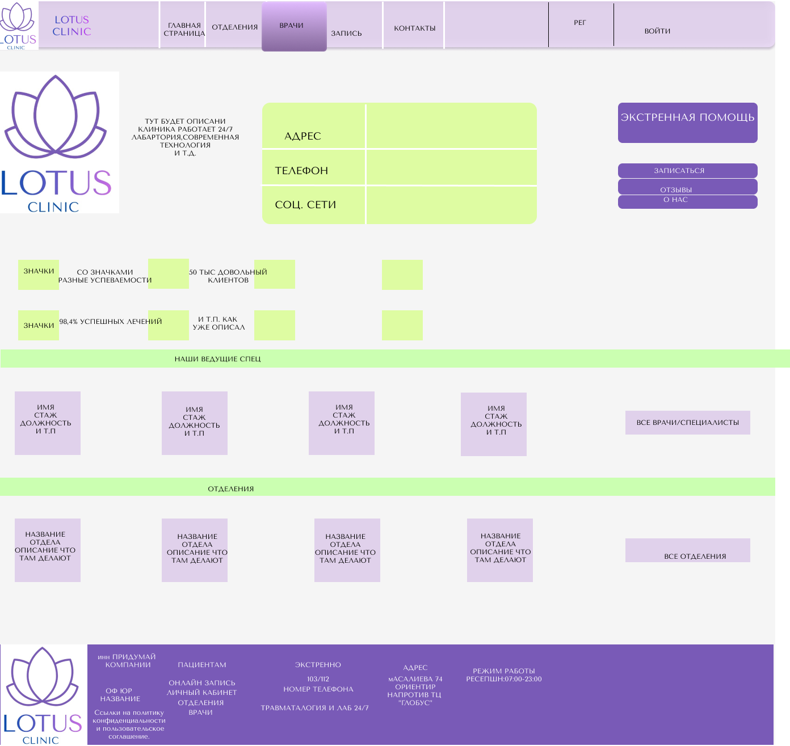
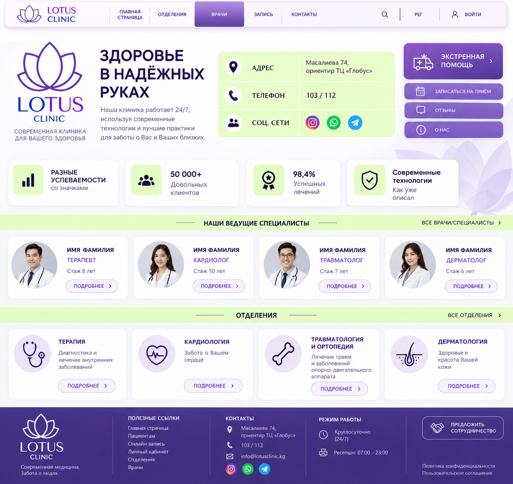
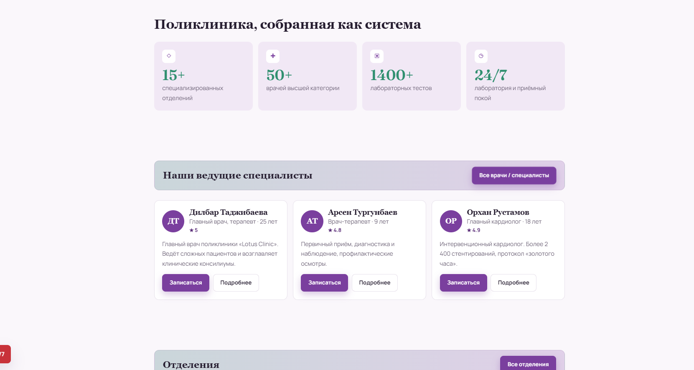
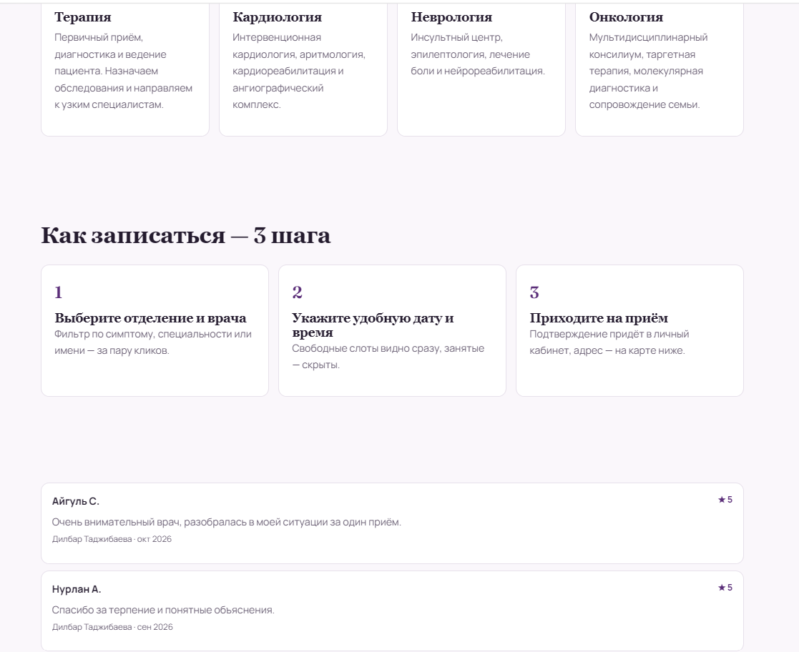

# Design Evolution — From Figma to LOTUS CLINIC

**Four iterations of one product:** a low-fidelity Figma wireframe, the first coded **PHOENIX** prototype, the first **LOTUS CLINIC** redesign, and the current full-stack portfolio release.

[← Back to the project README](../README.md) · [Русская версия](DESIGN_EVOLUTION_RU.md) · [Live demo](https://lotus-clinic-web.onrender.com)

> **Image provenance:** All seven images below are screenshots supplied by the project creator, not stock images or AI-generated mockups. They document different stages and should not be read as a claim that each stage was production-ready. The clinician, appointment, and marketing content shown is fictional/demo material.

## At a glance

| 01 · Figma concept | 02 · PHOENIX prototype | 03 · LOTUS V1 | 04 · Current LOTUS |
| --- | --- | --- | --- |
|  |  |  |  |
| **Planning** page regions and navigation | **Implementing** the first role-based screens | **Redesigning** visual identity and content hierarchy | **Refining** the UI and connecting workflows to an API |

The original Figma concept already used the **LOTUS** name and flower motif. The first coded prototype was temporarily called **PHOENIX**, before the project returned to the LOTUS identity. This is why the screenshots do not show a simple one-way naming progression.

## 01 — Figma: structure before implementation

**Goal.** Establish the page structure before committing to code: site navigation, call-to-action buttons, contact information, doctor cards, department cards, and the footer.

**What the image reveals.** Lavender and lime were already part of the design direction. The large placeholder text and unbalanced spacing make it clear that this was a **wireframe**, not a finished interface.

**Decision carried forward.** Keep the prominent appointment path, doctor discovery, department navigation, and LOTUS flower identity — but redesign the typography, spacing, and content system.

## 02 — PHOENIX: the first coded prototype

| Chief-doctor dashboard | Doctor directory |
| --- | --- |
|  |  |

**Goal.** Move from static planning into a working prototype, including a chief-doctor dashboard, a schedule, patient lists, and a basic doctor directory.

**What needed improvement.** The gray-green palette, mixed type sizes, large blocks, and inconsistent visual emphasis made the interface look like an internal tool rather than a coherent clinic brand. The temporary-password alert illustrates a workflow that also needed security and account lifecycle work.

**Decision carried forward.** Preserve role-specific workflows and the useful information hierarchy of the dashboard. Replace the visual language and progressively move beyond demonstration-only screens.

## 03 — LOTUS V1: brand direction, not yet design consistency

**Goal.** Restore LOTUS branding and make the public pages feel more recognizable and approachable.

**Improvement over PHOENIX.** A consistent flower logo, purple navigation, icon-based information cards, clinician cards, and dedicated department areas created a much clearer visual identity.

**Remaining problems.** The screen was crowded, with multiple competing accent colors and dense card layouts. Some marketing claims in the mockup (such as customer counts or success rates) were placeholders, not verified healthcare outcomes. They should never be presented as measured results.

**Design decision.** Simplify visual hierarchy: fewer competing accents, more controlled whitespace, a clearer primary action, and typography that works across desktop and mobile.

## 04 — LOTUS CLINIC today: a connected full-stack experience

| Clinician discovery | Booking guidance and content |
| --- | --- |
|  |  |

**Visible improvements.** More breathing room, restrained purple and green accents, more readable typography, clearer button hierarchy, and a responsive presentation that no longer depends on the original placeholder grid.

**Engineering improvements.** The current release connects public browsing and appointment booking with patient/doctor/chief roles, consultation notes, prescriptions, laboratory referrals, room assignments, leave requests, and pharmacy operations via **Express, Prisma, and MySQL**. These are not all visible in the public screenshots because the restricted dashboards require authentication.

**Evidence, not hype.** The read-only public deployment smoke test passed **18/18 checks on 30 October 2026**. This covers reachability and some anonymous access restrictions, not all role boundaries or a penetration test. See [QA checklist](QA_CHECKLIST.md).

## What I learned

1. **Wireframes are temporary tools.** The first concept established information structure; it was not worth reproducing pixel-for-pixel.
2. **A working dashboard still needs a design system.** PHOENIX established functions, but the appearance and interaction patterns needed a second pass.
3. **Branding is more than renaming.** LOTUS V1 had a recognizable identity, yet visual hierarchy and readability still needed work.
4. **UX and data architecture reinforce each other.** Doctor schedules, booking status, consultations, and inventory become more credible when the same data is available across roles and browsers.
5. **Demo content must be labeled.** Fictional names, marketing statistics, and sample contact details are placeholders, not evidence about a real clinic.

## Explore the implementation

- [Source code and live demo](../README.md)
- [System architecture](ARCHITECTURE.md)
- [Portfolio case study (Russian)](CASE_STUDY_RU.md)
- [Public release QA checklist](QA_CHECKLIST.md)

---

**Scope:** Independent educational portfolio project using fictional data. Not designed, validated, or approved to process real patients' medical information.
