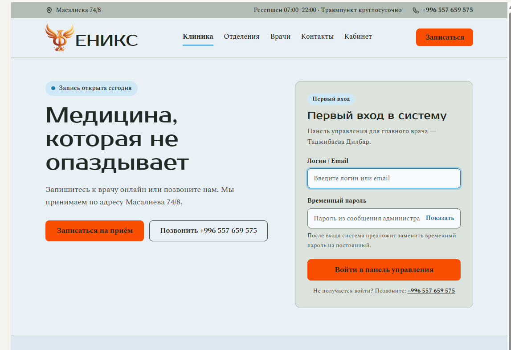
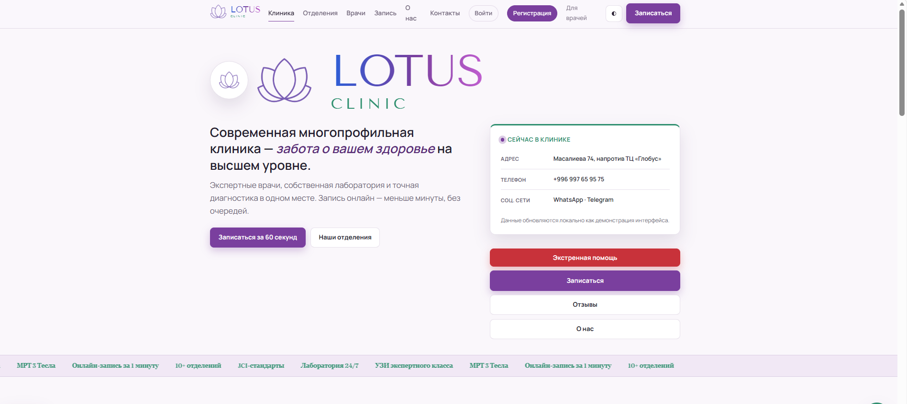
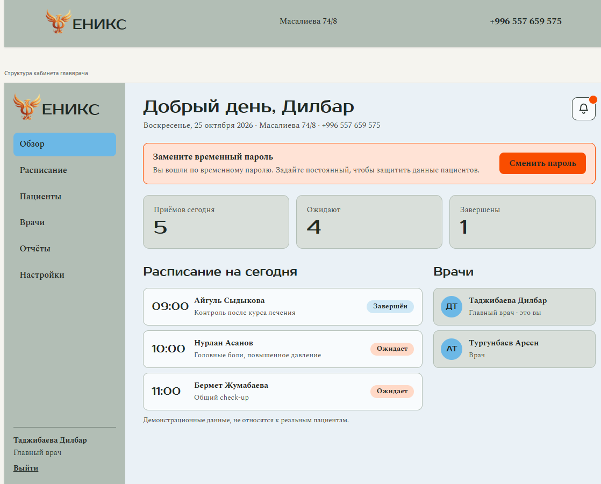
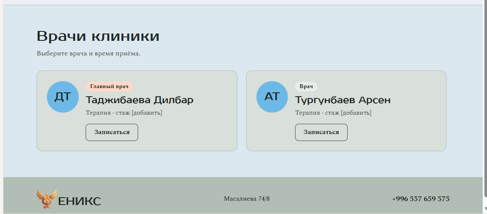

# LOTUS CLINIC — Design Evolution, from Figma to Full-Stack

**Five chronological stages, nine authentic screenshots, one evolving project.** This case documents the change from early Figma layouts through the PHOENIX demo and a transitional LOTUS design to the deployed application.

[← Project README](../README.md) · [Русская версия](DESIGN_EVOLUTION_RU.md) · [Live website](https://lotus-clinic-web.onrender.com)

> **About the images.** These are screenshots of the creator's own iterations, not stock images or AI-generated mockups. Early screens contain illustrative contact details, names, reviews, and marketing figures; they do not establish real clinical outcomes or the existence of a healthcare provider. This is an educational portfolio project, not a system for real patient data.

## The timeline — five stages

| 01 · Early Figma | 02 · Refined Figma | 03 · PHOENIX demo | 04 · Transitional LOTUS | 05 · Final LOTUS |
| --- | --- | --- | --- | --- |
|  |  |  |  |  |
| Layout exploration | Visual concept refinement | First coded demo | New brand on the earlier UI | Unified interface and backend |

**Brand chronology matters:** the earliest Figma concept already said **LOTUS**. The first coded demo used the working name **PHOENIX**; later the project returned to LOTUS, first reusing some PHOENIX interface patterns and then receiving a more complete redesign.

---

## 01. Early Figma — laying out the concept

**What it was:** a rough layout rather than a functional website. Navigation, the logo, contact area, booking actions, clinician cards, departments, and the footer were arranged into an initial structure.

**What needed work:** uneven spacing, temporary copy, inconsistent card dimensions, and no coherent type scale. Lavender and lime accents and the LOTUS motif were already present.

**Outcome:** a visual map of the future homepage and a first set of navigation priorities.

## 02. Refined Figma — a more detailed visual concept

**What improved:** clearer hierarchy, image-backed clinician cards, more complete department and contact sections, stronger calls to action, and a more recognizable identity.

**What remained open:** consistent spacing and component styles, the balance between accent colors, and how the layout would behave when implemented. This was still a **Figma mockup**, not the finished site.

**Outcome:** a richer visual reference for the first implementation.

## 03. PHOENIX — the first coded demo

### Homepage and first sign-in

### Chief-doctor dashboard and clinician directory

| Chief-doctor dashboard | Doctor directory |
| --- | --- |
|  |  |

**What arrived:** an actual demo interface with a homepage, first-login form, chief-doctor navigation, schedule views, and doctor cards.

**Why it needed a redesign:** the sage-gray palette and bright orange actions did not form a consistent identity; typography and spacing varied between the public and administration views.

**What carried forward:** role-specific workflows, schedule presentation, and the idea of clinician management. The brand and visual system were reconsidered.

## 04. Transitional LOTUS — a new name on PHOENIX-era interface patterns

### Homepage

### Specialists and departments

### Booking explanation and reviews

**What changed:** the LOTUS name and flower identity returned, lavender accents became more prominent, and additional interface content appeared: clinician cards, information sections, booking guidance, and reviews.

**Why it was not yet final:** parts of the composition and visual logic still descended from PHOENIX. Cards, buttons, type styles, and emphasis remained uneven across sections.

**Design decision:** redesign hierarchy and interaction patterns rather than simply reskinning the old site.

## 05. Final LOTUS CLINIC — unified design and a connected full-stack app

*This is the real published homepage screenshot already stored in `docs/screenshots/home-desktop.png`, not a transitional screen or an invented rendering.*

**Visual result:** a calmer and more coherent composition, a consistent palette and component language, clearer primary actions, responsive navigation, and improved mobile presentation.

**Engineering result:** the educational project grew into a connected application. A vanilla HTML/CSS/JavaScript frontend calls an Express API. Prisma and MySQL handle users, appointments, consultations, prescriptions, laboratory orders, rooms, and pharmacy inventory. Patient, clinician, and chief-doctor flows are separated by server-side authorization.

**Evidence, without overclaiming:** the public read-only smoke test passed **18/18 checks on 30 October 2026**, covering availability and anonymous access barriers. This is not a penetration test, medical certification, or verification of every authorization scenario.

## Lessons from the process

- **Figma informed the structure and visual goals**, but did not dictate a pixel-perfect final implementation.
- **PHOENIX demonstrated the first functional workflows**, yet also exposed the need for a shared design language.
- **Changing the name was not enough:** transitional LOTUS still relied on earlier layout decisions, motivating a larger redesign.
- **A shared backend connected the user journeys**, rather than leaving patient, clinician, and administration screens as unrelated demonstrations.
- **Preserving imperfect early work makes the case stronger** by showing why the product changed.

## Explore the project

[Live demo](https://lotus-clinic-web.onrender.com) · [Architecture](ARCHITECTURE.md) · [Portfolio case study](CASE_STUDY_RU.md) · [QA checklist](QA_CHECKLIST.md)

---

**LOTUS CLINIC is an independent educational portfolio demo using fictional content. It is not suitable for real healthcare data.**
